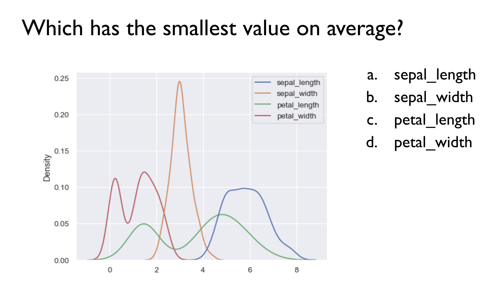
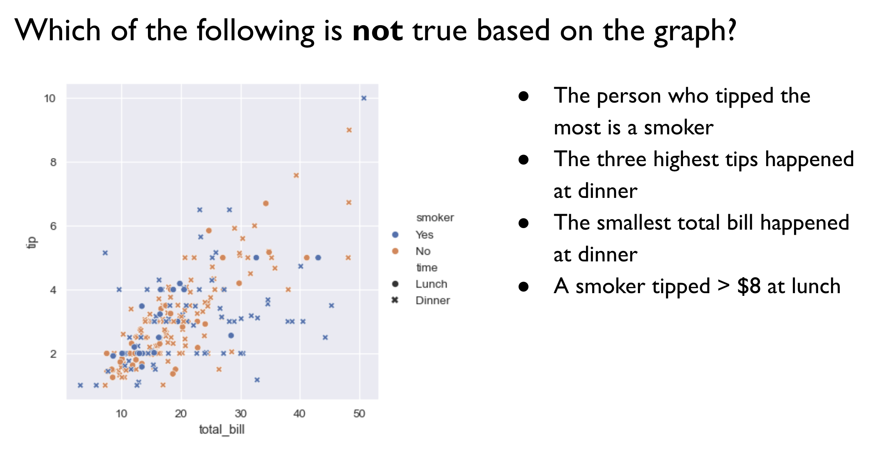
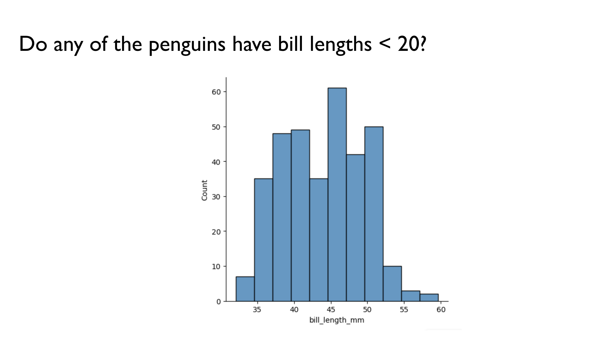
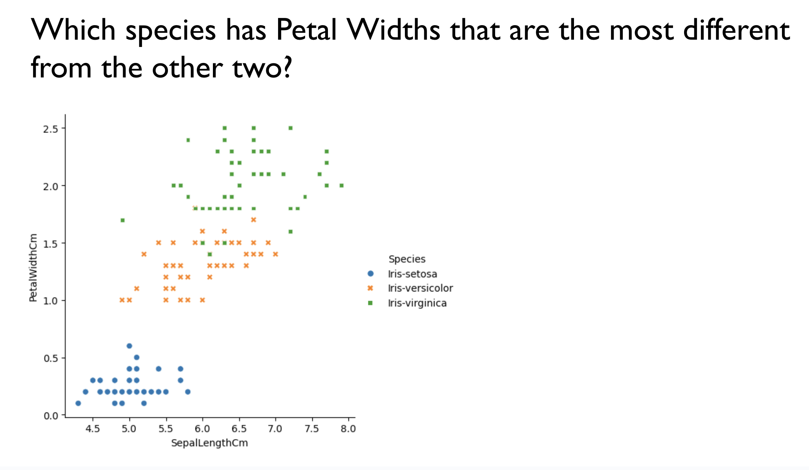
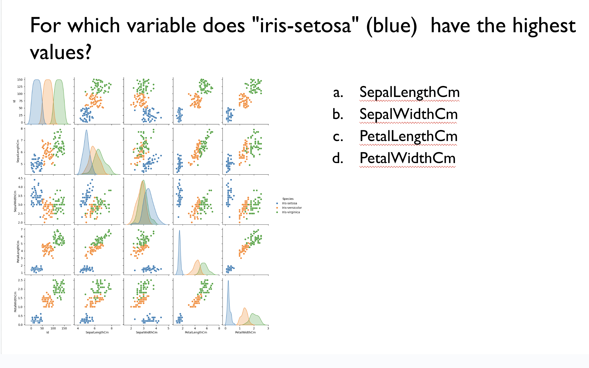

# Lab 9

Links to roller coaster dataset:
* coasters.csv: https://drive.google.com/file/d/1OWspBvnysh6Bf7dyBLywId6ZVS1RzXgV/view?usp=sharing
* parks.csv: https://drive.google.com/file/d/14WvN9oId5zdBVkqRZggxnn3WnH5CJ-qy/view?usp=sharing

Links to penguins dataset:
* penguins.csv: https://drive.google.com/file/d/1ESxaIakPh6IpsA_x1H1798003CuqJP8r/view
* penguin_species.csv: https://drive.google.com/file/d/1ZuDVMF-6BM6bKV2SHKwkg9sG2w8OCh5-/view?usp=sharing


## Joining Data Frames

### Code from class:

```
penguins = pd.read_csv("penguins.csv")
species = pd.read_csv("penguin_species.csv")

# inner join
penguins.merge(species, how = "inner", left_on = "species", right_on = "name")

# outer join
penguins.merge(species, how = "outer", left_on = "species", right_on = "name")

# left join
penguins.merge(species, how = "left", left_on = "species", right_on = "name")

# right join
penguins.merge(species, how = "right", left_on = "species", right_on = "name")
```

## Plotting

### Code from class:

```
# histogram
sns.displot(penguins, x = "flipper_length_mm", hue = "island")

# kde plot
sns.displot(penguins, x = "flipper_length_mm", hue = "island", kind = "kde")

# scatter plot
sns.relplot(penguins, x = "bill_length_mm", y = "bill_depth_mm", col = "sex", size = "body_mass_g", hue = "species")

# swarm plot
sns.catplot(penguins, x = "species", y = "body_mass_g", hue = "sex")

# box plot
sns.catplot(penguins, x = "species", y = "body_mass_g", hue = "sex", kind = "box")
```


## Aggregation

| Function | Description |
|--|--|
| `.mean()` | Average |
| `.sum()`  | Sum total | 
| `.count()` | Number of non-null values |
| `min()` | Smallest value |
| `max()` | Largest value |
| `median()` | Median value |
| `.std()` | Standard deviation | 
| `.var()` | Variance | 
| `.nunique()`  | The number of unique values |

### Code from class:

```
# pairplot
sns.pairplot(penguins, hue = "species")

# mean body mass of each species
penguins.groupby("species")["body_mass_g"].mean()

# median body mass from each island
penguins.groupby("island")["body_mass_g"].median()

# minimum body mass by sex
penguins.groupby("sex")["body_mass_g"].min()

# plotting result
grouped_result = penguins.groupby("species")["body_mass_g"].median().reset_index()
sns.barplot(grouped_result, x = "species", y = "body_mass_g")
```

## Part 1: Plot interpretation questions
Answer the following plot interpretation questions.

1. 


2. 


3. 


4. 


5. 


## Part 2: Data analysis questions

1. Download this bikesharing data:
   * `bikesharing.csv`: [https://drive.google.com/file/d/1r_5a9odlnxs1DGPbvWP-s8hsdxOWBO14/view?usp=sharing](https://drive.google.com/file/d/1O32iI5wnlsNWNyuXuE0QhmSP-X6u5p3N/view?usp=sharing)
   * `monthly_info.csv`: https://drive.google.com/file/d/1GBJ3QyVpE31v8kPWCL-4epPFRThrpuL9/view?usp=sharing
     
2. Load these two dataframes into pandas and join them, saving the result as a new variable.  What columns should you merge on? What kind of merge should you use?
   
3. Change the type of the `date`  and `date_noyear` to datetime objects using the following lines of code (replace `df`  with the name of your dataframe):
   
```
df['date'] = pd.to_datetime(df['date'])
df['date_noyear'] = pd.to_datetime(df['date_noyear'])
```

Note: this allows Python to interpret these columns as dates rather than strings, which improves plotting.

4. Make a pairplot for this merged data. Which two variables have the strongest linear relationship (as one variable increases, the other tends to increase)?

5. Use `sns.relplot()` to make a plot with this data. You can use additional arguments to try to make as interesting/informative of a plot as possible.
    
6. What can you learn from the plot you created?
    
7. Use `sns.catplot()` to make a plot with this data. You can use additional arguments to try to make as interesting/informative of a plot as possible.
    
8. What can you learn from the plot you created?

9. Find the median number of *casual* riders per weekday (group by weekday, and find the median of `casual`). Which weekdays are most popular for casual riders?
   
10. Make a bar plot of the median number of casual riders per weekday.
   
11. Find the median number of *registered* riders per weekday (group by weekday, and find the median of `registered`). Which weekdays are most popular for registered riders?


